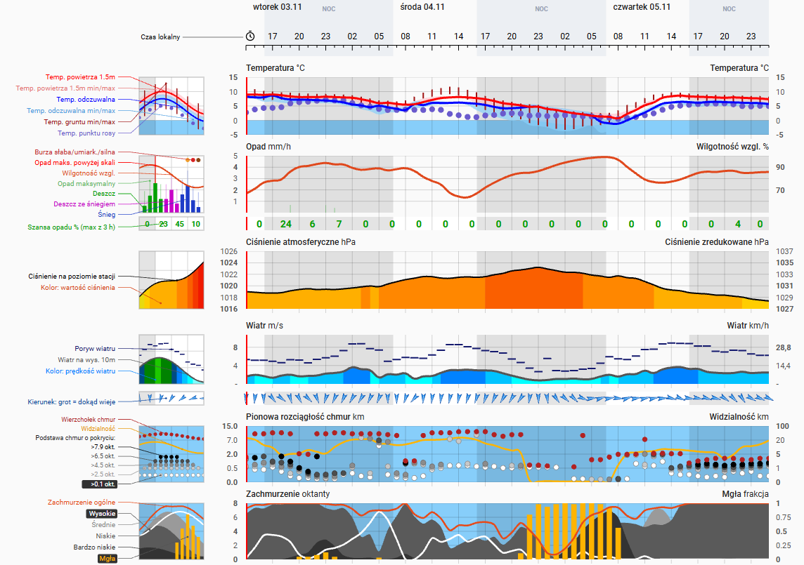
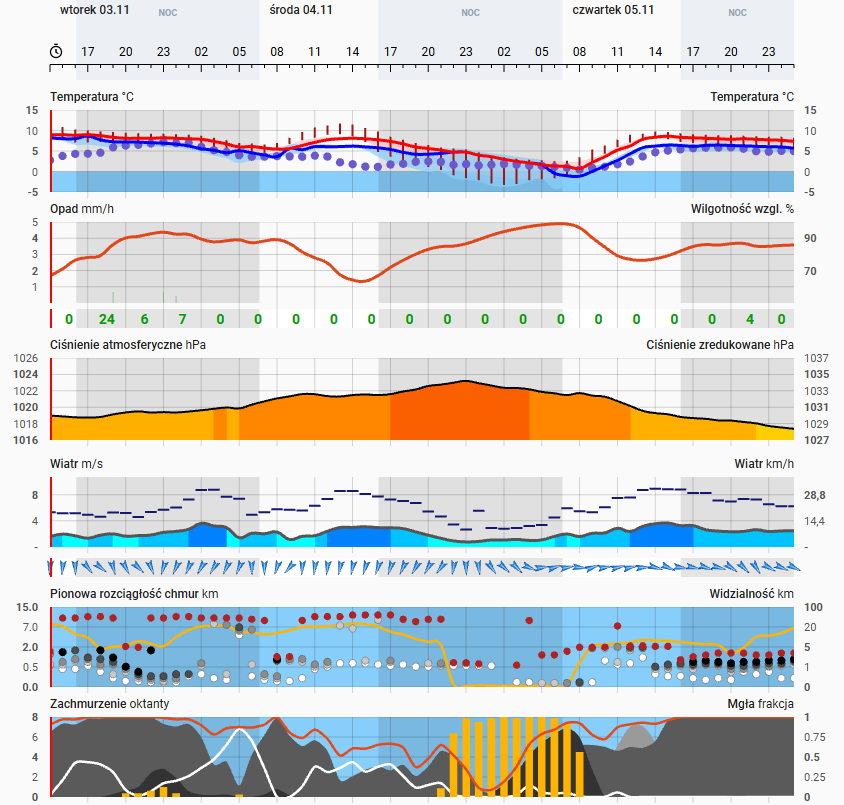
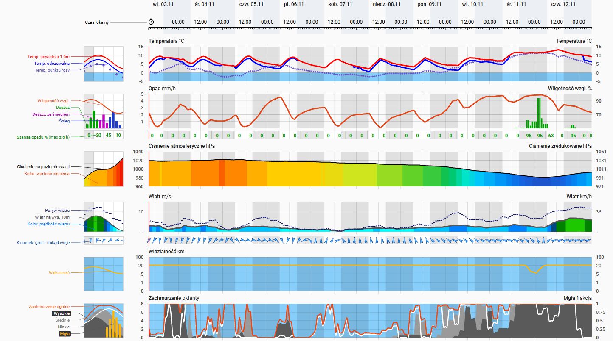
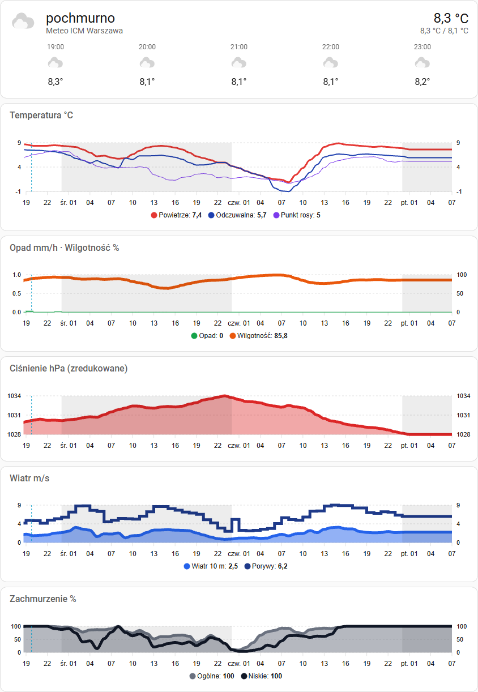

# Meteo ICM (meteo.pl) for Home Assistant

[Wersja polska](README.md)

An unofficial Home Assistant integration that fetches forecasts from the ICM UW meteograms
([meteo.pl](https://www.meteo.pl/meteogramy)) for any location in Poland, together with a Lovelace
card that draws the meteogram in the familiar meteo.pl layout.



## Features

- Location given as a place name (meteo.pl geocoder) or as `latitude, longitude` coordinates.
- Forecast range chosen when adding the integration: **60 h** (UM 4 km model, `um4_60`) or **240 h** (GFS model, `gfs`).
- A `weather` entity with current conditions and an hourly forecast (works with the Weather forecast card).
- A sensor carrying the full meteogram in its attributes (34 hourly series), for your own charts.
- The `custom:meteo-icm-card` card is registered automatically by the integration — no manual resource needed.
- No API key and no extra Python dependencies.

## Installation

### HACS (custom repository)

1. HACS → ⋮ menu → **Custom repositories** → this repository's URL, type **Integration**.
2. Search for "Meteo ICM" in HACS, install it and restart Home Assistant.

### Manual

Copy `custom_components/meteo_icm` into `<config>/custom_components/` and restart Home Assistant.

## Configuration

**Settings → Devices & services → Add integration → Meteo ICM**

1. Enter a place (e.g. `Warszawa`) or coordinates (e.g. `52.23, 21.01`) and choose the forecast range: 60 h or 240 h.
2. If the name matches several places, pick the right one from the list.

The range cannot be changed once saved. To have both forecasts for the same place, add the integration
a second time with the other range — each location + range pair is a separate entry.

## Entities

The device is named "Meteo ICM &lt;place&gt;", or "Meteo ICM &lt;place&gt; 240 h" for the 240 h forecast.
Entities for Warsaw (for 240 h: `weather.meteo_icm_warszawa_240_h` and `sensor.meteo_icm_warszawa_240_h_meteogram`):

| Entity | Description |
|---|---|
| `weather.meteo_icm_warszawa` | "Now" values (the forecast hour covering the current time): temperature, apparent temperature, dew point, humidity, pressure, wind and gusts, bearing, cloud coverage, visibility; hourly forecast. The `condition` is derived heuristically from clouds, precipitation, storm, fog and the sun position. |
| `sensor.meteo_icm_warszawa_meteogram` | State = model run time. Attributes: `model`, `latitude`, `longitude`, `first_ts` (unix, start of the series), `interval` (s, usually 3600) and the series arrays. |

The *i*-th element of every series refers to `first_ts + i * interval`. Series in the sensor attributes:

| Group | Attributes | Unit |
|---|---|---|
| Temperature | `temperature`, `temperature_min`, `temperature_max`, `apparent_temperature`, `apparent_temperature_min`, `apparent_temperature_max`, `dew_point`, `ground_temperature_min`, `ground_temperature_max` | °C |
| Precipitation | `precipitation`, `precipitation_max` · `precipitation_probability` · `precipitation_type` (raw model code) | mm/h · % · — |
| Storm | `storm`, `flash` | — |
| Humidity | `humidity` | % |
| Pressure | `pressure` (reduced to sea level), `pressure_station` (at station level) | hPa |
| Wind | `wind_speed`, `wind_gust` · `wind_bearing` | m/s · ° |
| Clouds | `cloud_coverage`, `cloud_very_low`, `cloud_low`, `cloud_medium`, `cloud_high`, `fog` | % |
| Vertical cloud extent | `cloud_top`, `cloud_base_01`, `cloud_base_25`, `cloud_base_45`, `cloud_base_65`, `cloud_base_79` (base of clouds with coverage > 0.1 / 2.5 / 4.5 / 6.5 / 7.9 oktas) | km |
| Visibility | `visibility` | km |

The GFS model (240 h) does not provide min/max and ground temperatures, storms, maximum precipitation,
very low clouds or vertical cloud extent — those attributes are absent then.

The sensor attributes are excluded from the recorder — they are large arrays.

## Data refresh

Every 30 minutes the integration checks whether ICM has published a new model run (a lightweight request).
The full meteogram is downloaded only when the run is new — i.e. a few times a day.

## Meteogram card

The card draws the meteogram in the meteo.pl layout: a time axis with night bands, temperature,
precipitation and humidity with precipitation chance, pressure, wind with direction, vertical cloud
extent with visibility, and cloud cover in oktas with fog. Night bands use the actual sunset and
sunrise times for the forecast coordinates.

The same card handles both ranges. Panels and the legend show only the series the model provides
(for 240 h, visibility alone replaces the vertical cloud extent). The axis density — how often hour
labels, precipitation-chance windows and wind arrows appear — adapts to the card width.

```yaml
type: custom:meteo-icm-card
entity: sensor.meteo_icm_warszawa_meteogram
```

| Option | Default | Description |
|---|---|---|
| `entity` | — (required) | A `sensor.meteo_icm_*_meteogram` sensor. |
| `legend` | `left` | `left` — legend with thumbnails on the left (as in the meteo.pl "classic meteogram"), `bottom` — legend below the panels, `none` — no legend. When the left legend does not fit (e.g. on a phone), the card switches to `bottom` by itself. |
| `min_hour_width` | 60 h: `12` (`10` with the left legend), 240 h: `3` | Minimum width of one hour in px. When the chart does not fit the card, it scrolls horizontally. |
| `title` | — | Card header. |

The card fits the width of its column or section; it looks best in a **Panel** view.

Without the legend (`legend: none`):



The 240 h forecast (`sensor.meteo_icm_warszawa_240_h_meteogram`, legend on the left):



The card labels are in Polish.

## Optional apexcharts-card dashboard

[`dashboard/meteogram-apexcharts.yaml`](dashboard/meteogram-apexcharts.yaml) is an alternative to the
card: a Weather forecast card plus five [apexcharts-card](https://github.com/RomRider/apexcharts-card)
charts (temperature, precipitation and humidity, pressure, wind, cloud cover) fed from the sensor attributes.

1. Install **ApexCharts Card** from HACS (Frontend).
2. Edit a dashboard → **Add card** → **Manual** and paste the file contents.
3. Replace `bydgoszcz` in the entity IDs with your location (e.g. `warszawa`).

The time axis is labelled every 3 hours (`tickAmount: 20` for `graph_span: 60h`); when changing
`graph_span`, scale `tickAmount` accordingly — see the comment at the top of the file.

To show which day the hours belong to, the first label of each day carries the weekday abbreviation
(e.g. "śr. 01"), and every other day has a grey background on all charts. Every chart has an axis
on both sides (the right one repeats the left ticks, except precipitation with humidity), and the plot areas have fixed margins, so the hours line up across all charts. Precipitation is drawn as steps instead of columns, because columns shift the time scale.



## Notes

- The integration uses the same API as the meteo.pl/meteograms page (`devmgramapi.meteo.pl`,
  geocoder `nom-proxy.dev.meteo.pl`). The API is not publicly documented and may change without notice.
- Data: ICM UW, [meteo.pl](https://www.meteo.pl). This project is not affiliated with ICM — see the [disclaimer](DISCLAIMER.md#english).
- The card code is an independent implementation; only the chart layout follows meteo.pl.
