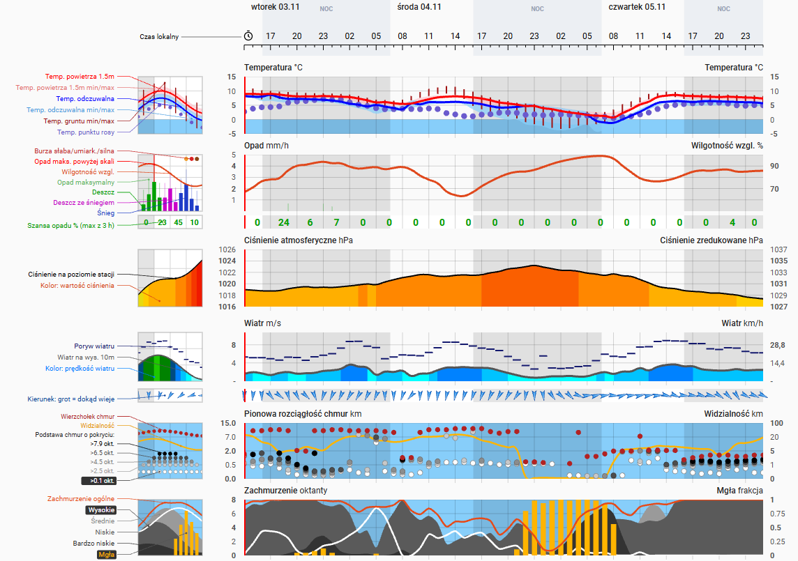
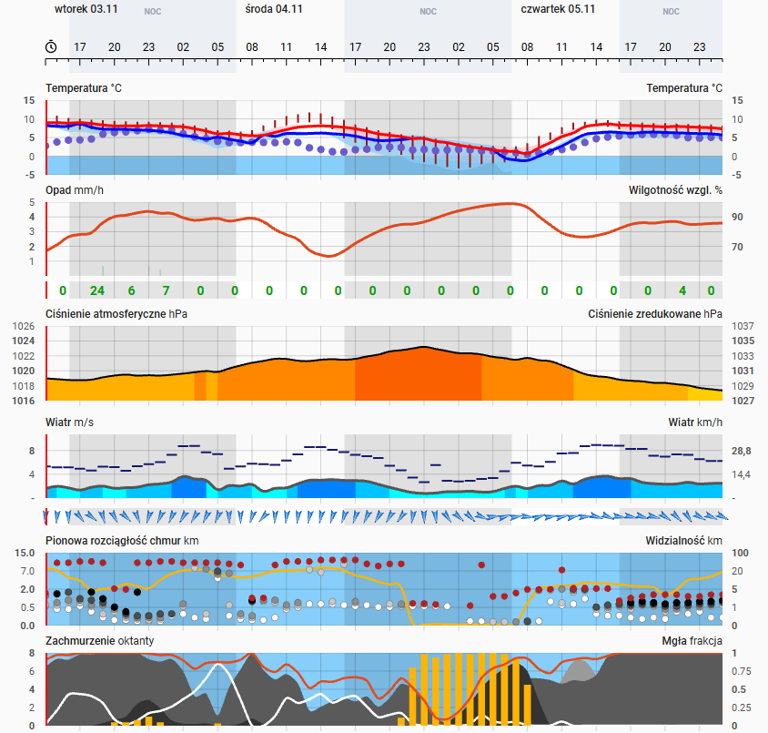
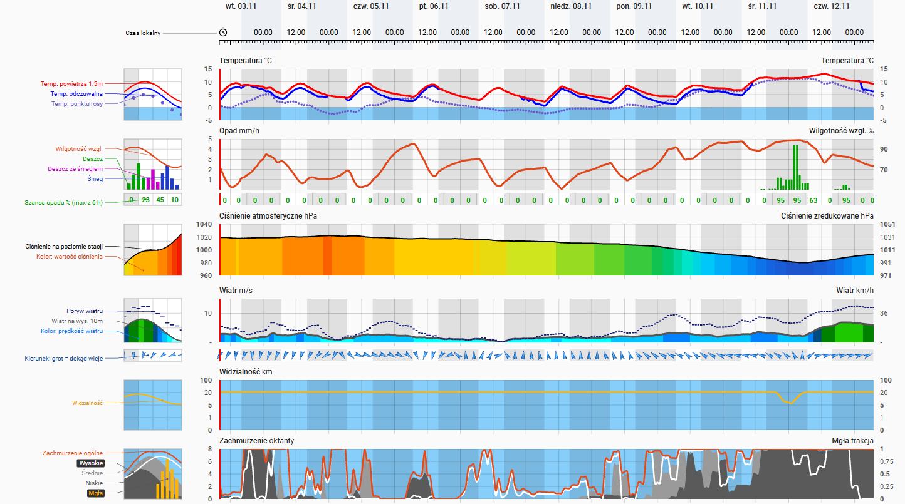
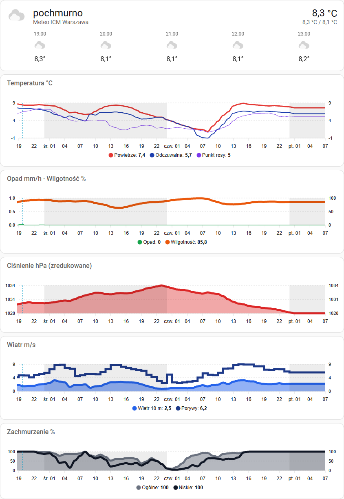

# Meteo ICM (meteo.pl) dla Home Assistant

[English version](README.en.md)

Nieoficjalna integracja Home Assistant pobierająca prognozy z meteogramów ICM UW
([meteo.pl](https://www.meteo.pl/meteogramy)) dla dowolnej lokalizacji w Polsce,
wraz z kartą Lovelace rysującą meteogram w układzie znanym z meteo.pl.



## Funkcje

- Lokalizacja podawana nazwą miejscowości (wyszukiwarka meteo.pl) albo współrzędnymi `szerokość, długość`.
- Zakres prognozy wybierany przy dodawaniu: **60 h** (model UM 4 km, `um4_60`) albo **240 h** (model GFS, `gfs`).
- Encja `weather` z bieżącymi warunkami i prognozą godzinową (działa z kartą „Prognoza pogody”).
- Sensor z pełnym meteogramem w atrybutach (34 serie godzinowe) — do własnych wykresów.
- Karta `custom:meteo-icm-card` rejestrowana automatycznie przez integrację — bez ręcznego dodawania zasobu.
- Bez klucza API i bez dodatkowych zależności Pythona.

## Instalacja

### HACS (repozytorium niestandardowe)

1. HACS → menu ⋮ → **Niestandardowe repozytoria** → adres tego repozytorium, typ **Integracja**.
2. Wyszukaj „Meteo ICM” w HACS, zainstaluj i zrestartuj Home Assistant.

### Ręcznie

Skopiuj katalog `custom_components/meteo_icm` do `<config>/custom_components/` i zrestartuj Home Assistant.

## Konfiguracja

**Ustawienia → Urządzenia i usługi → Dodaj integrację → Meteo ICM**

1. Wpisz miejscowość (np. `Warszawa`) lub współrzędne (np. `52.23, 21.01`) i wybierz zakres prognozy: 60 h lub 240 h.
2. Jeśli nazwa pasuje do kilku miejscowości, wybierz właściwą z listy.

Zakresu nie można zmienić po zapisaniu. Aby mieć obie prognozy dla tej samej miejscowości, dodaj integrację
drugi raz z drugim zakresem — każda para lokalizacja + zakres to osobny wpis.

## Encje

Nazwa urządzenia to „Meteo ICM &lt;miejscowość&gt;”, a dla prognozy 240 h „Meteo ICM &lt;miejscowość&gt; 240 h”.
Encje dla Warszawy (dla 240 h: `weather.meteo_icm_warszawa_240_h` i `sensor.meteo_icm_warszawa_240_h_meteogram`):

| Encja | Opis |
|---|---|
| `weather.meteo_icm_warszawa` | Warunki „teraz” (godzina prognozy obejmująca bieżący czas): temperatura, odczuwalna, punkt rosy, wilgotność, ciśnienie, wiatr i porywy, kierunek, zachmurzenie, widzialność; prognoza godzinowa. Stan (`condition`) wyznaczany z zachmurzenia, opadu i jego rodzaju, burzy, mgły, porywów i położenia słońca, z progami ikon meteo.pl. Opad śladowy (`precipitation_type` 0) nie zmienia stanu i nie jest rysowany na karcie. Opad i jego szansa we wpisie prognozy dotyczą godziny, która się o tym czasie zaczyna. |
| `sensor.meteo_icm_warszawa_meteogram` | Stan = czas przebiegu modelu. Atrybuty: `model`, `latitude`, `longitude`, `first_ts` (unix, początek serii), `interval` (s, zwykle 3600) oraz tablice serii. |
| `sensor.meteo_icm_warszawa_ostatnia_synchronizacja` | Diagnostyczny: data i godzina ostatniej udanej synchronizacji z meteo.pl (także gdy nie było nowego przebiegu). |
| `button.meteo_icm_warszawa_pobierz_dane` | Pobiera meteogram od razu, nawet gdy przebieg modelu się nie zmienił. Gdy się nie uda, zgłasza błąd, a dane zostają. |

Identyfikatory sensora synchronizacji i przycisku powstają z nazw w języku HA (po angielsku: `…_last_synchronization`, `…_refresh_data`).

Wartość *i*-tego elementu serii dotyczy czasu `first_ts + i * interval`; opad i burza to sumy za godzinę kończącą się o tym czasie. Serie w atrybutach sensora:

| Grupa | Atrybuty | Jednostka |
|---|---|---|
| Temperatura | `temperature`, `temperature_min`, `temperature_max`, `apparent_temperature`, `apparent_temperature_min`, `apparent_temperature_max`, `dew_point`, `ground_temperature_min`, `ground_temperature_max` | °C |
| Opad | `precipitation`, `precipitation_max` · `precipitation_probability` · `precipitation_type` (0 brak/śladowy, 1 deszcz, 2 śnieg, 3 deszcz ze śniegiem) | mm/h · % · — |
| Burza | `storm` (> 0: możliwa burza) · `flash` (wyładowania na godzinę) | — · 1/h |
| Wilgotność | `humidity` | % |
| Ciśnienie | `pressure` (zredukowane do poziomu morza), `pressure_station` (na poziomie stacji) | hPa |
| Wiatr | `wind_speed`, `wind_gust` · `wind_bearing` | m/s · ° |
| Zachmurzenie | `cloud_coverage`, `cloud_very_low`, `cloud_low`, `cloud_medium`, `cloud_high`, `fog` | % |
| Chmury pionowo | `cloud_top`, `cloud_base_01`, `cloud_base_25`, `cloud_base_45`, `cloud_base_65`, `cloud_base_79` (podstawa chmur o pokryciu > 0.1 / 2.5 / 4.5 / 6.5 / 7.9 okt.) | km |
| Widzialność | `visibility` | km |

Model GFS (240 h) nie podaje temperatur min/max i gruntu, burz, opadu maksymalnego, chmur bardzo niskich
ani pionowej rozciągłości chmur — tych atrybutów wtedy nie ma.

Atrybuty sensora nie są zapisywane w historii (recorderze) — to duże tablice.

## Odświeżanie danych

Co 30 minut integracja sprawdza, czy ICM opublikował nowy przebieg modelu (lekkie zapytanie).
Pełny meteogram jest pobierany tylko wtedy, gdy przebieg jest nowy — czyli kilka razy na dobę.

Gdy meteo.pl nie odpowiada, encje nie stają się niedostępne: zostaje ostatni pobrany meteogram, a sensor
„Ostatnia synchronizacja” pokazuje, z kiedy są dane. Gdy stara prognoza się skończy, prognoza godzinowa
jest pusta. Ostatnie dane są trzymane tylko w pamięci, więc po restarcie HA przy niedostępnym API
integracja czeka na pierwsze udane pobranie.

## Karta meteogramu

Karta rysuje meteogram w układzie meteo.pl: oś czasu z pasami nocy, temperatura, opad i wilgotność
z szansą opadu, ciśnienie, wiatr z kierunkiem, pionowa rozciągłość chmur z widzialnością,
zachmurzenie w oktantach z mgłą. Pasy nocy to rzeczywiste godziny zachodu i wschodu słońca
dla współrzędnych prognozy.

Ta sama karta obsługuje oba zakresy. Panele i legenda pokazują tylko serie, które podaje model
(dla 240 h zamiast pionowej rozciągłości chmur jest sama widzialność). Gęstość osi, czyli co ile godzin
są etykiety, okna szansy opadu i strzałki wiatru, dopasowuje się do szerokości karty.

```yaml
type: custom:meteo-icm-card
entity: sensor.meteo_icm_warszawa_meteogram
```

| Opcja | Domyślnie | Opis |
|---|---|---|
| `entity` | — (wymagana) | Sensor `sensor.meteo_icm_*_meteogram`. |
| `legend` | `left` | `left` — legenda z miniaturami po lewej (jak w „klasycznym meteogramie” meteo.pl), `bottom` — legenda pod panelami, `none` — bez legendy. Gdy legenda po lewej się nie mieści (np. telefon), karta sama przechodzi na `bottom`. |
| `min_hour_width` | 60 h: `12` (`10` przy legendzie po lewej), 240 h: `3` | Minimalna szerokość godziny w px. Gdy wykres nie mieści się w karcie, pojawia się przewijanie poziome. |
| `title` | — | Nagłówek karty. |

Karta dopasowuje się do szerokości kolumny lub sekcji; najlepiej wygląda w widoku typu **Panel**.

Bez legendy (`legend: none`):



Prognoza 240 h (`sensor.meteo_icm_warszawa_240_h_meteogram`, legenda po lewej):



## Opcjonalny dashboard z apexcharts-card

Plik [`dashboard/meteogram-apexcharts.yaml`](dashboard/meteogram-apexcharts.yaml) to alternatywa
dla karty: karta „Prognoza pogody” oraz pięć wykresów
[apexcharts-card](https://github.com/RomRider/apexcharts-card) (temperatura, opad i wilgotność,
ciśnienie, wiatr, zachmurzenie) zasilanych atrybutami sensora.

1. Zainstaluj **ApexCharts Card** z HACS (sekcja Frontend).
2. Edytuj dashboard → **Dodaj kartę** → **Ręcznie** i wklej zawartość pliku.
3. Zamień `bydgoszcz` w nazwach encji na swoją lokalizację (np. `warszawa`).

Oś czasu ma etykiety co 3 godziny (`tickAmount: 20` przy `graph_span: 60h`); zmieniając `graph_span`,
zmień proporcjonalnie `tickAmount` — szczegóły w komentarzu na początku pliku.

Żeby było widać, której doby dotyczą godziny, pierwsza etykieta każdej doby ma skrót dnia tygodnia
(np. „śr. 01”), a co druga doba ma na wszystkich wykresach szare tło. Każdy wykres ma oś po obu
stronach (po prawej te same podziałki co po lewej, poza opadem z wilgotnością), a pola wykresów mają stałe marginesy - godziny na osiach pokrywają się we wszystkich wykresach. Opad jest rysowany schodkami zamiast słupków, bo słupki przesuwają skalę czasu.



## Uwagi

- Integracja korzysta z tego samego API co strona meteo.pl/meteogramy
  (`devmgramapi.meteo.pl`, wyszukiwarka `nom-proxy.dev.meteo.pl`). API nie jest publicznie
  udokumentowane i może się zmienić bez zapowiedzi.
- Dane: ICM UW, [meteo.pl](https://www.meteo.pl). Projekt nie jest powiązany z ICM — zobacz [zastrzeżenia prawne](DISCLAIMER.md).
- Kod karty to własna implementacja; z meteo.pl przejęty jest wyłącznie układ wykresu.
